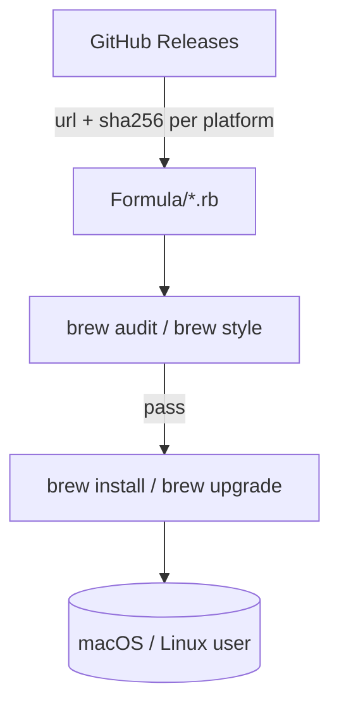

# Homebrew Tap

[](https://github.com/clouatre-labs/homebrew-tap/actions/workflows/audit.yml)
[](https://api.reuse.software/info/github.com/clouatre-labs/homebrew-tap)
[](LICENSE)

Homebrew tap for [clouatre-labs](https://github.com/clouatre-labs) projects.

## Installation

```bash
brew tap clouatre-labs/tap
```

## Available Formulas

| Formula | Description |
|---------|-------------|
| [aptu](https://github.com/clouatre-labs/aptu) | Gamified OSS issue triage with AI assistance |
| [aptu-coder](https://github.com/clouatre-labs/aptu-coder) | MCP server for code structure analysis using tree-sitter |

## Architecture



*Figure 1: Every formula pins a release tarball and SHA-256 per platform from
its upstream GitHub release. Formulas are validated with `brew audit`/`brew
style` and consumed via `brew install clouatre-labs/tap/<formula>`.*

## Publishing from a new repository

Formula updates are fully automated. A repository that publishes releases
here must wire its release workflow to the tap's automation contract:

1. **Configure CI credentials.** Formula commits must be made by a
   dedicated GitHub App (bot identity), not a personal access token or a
   human git config. Store the app's client ID and private key as
   repository secrets in the source repository, and install the app on
   this tap with `contents: write` and `pull requests: write` only.

2. **Commit via the GitHub App, never as a user.** Branch protection on
   `main` requires signed commits and pull requests enforce DCO. Raw
   `git commit --signoff` from CI produces an unsigned commit that blocks
   auto-merge. The required pattern is a `createCommitOnBranch` GraphQL
   mutation authenticated with a token minted by
   [`actions/create-github-app-token`](https://github.com/actions/create-github-app-token):
   GitHub signs such commits with its web-flow key (satisfying commit
   signature requirements), and the bot author is exempt from DCO.
   Reference implementations: the `update-homebrew` job in
   [aptu](https://github.com/clouatre-labs/aptu/blob/main/.github/workflows/release.yml)
   and
   [aptu-coder](https://github.com/clouatre-labs/aptu-coder/blob/main/.github/workflows/release.yml).

3. **Open a PR and enable auto-merge** (`gh pr merge --auto --squash`) so the
   update lands once the `Audit` check passes — no manual merging.

4. **Update the Available Formulas table above in the same change** when
   adding or removing a formula.

## Contributing

1. Fork this repository
2. Create a feature branch
3. Make your changes
4. Run `brew audit --strict --online Formula/<formula>.rb`
5. Run `brew style Formula/<formula>.rb`
6. Submit a pull request

## License

Each formula specifies its own license. See individual formula files for details.
Repository metadata is licensed [Apache-2.0](LICENSE) — see [REUSE.toml](REUSE.toml).
